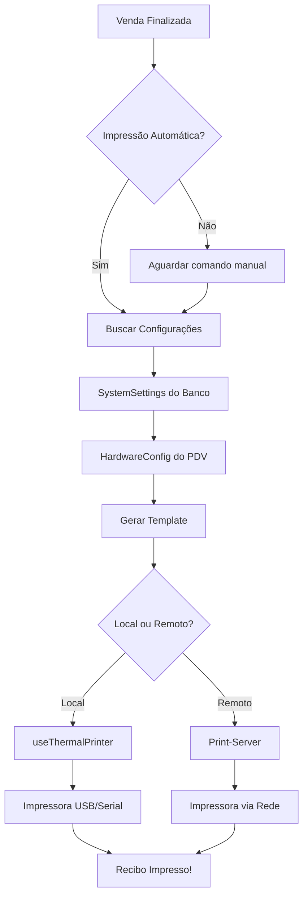

# 🎨 Configuração de Recibos - Sistema Melhorado

## 📋 O que foi melhorado?

### ✅ Melhorias Implementadas:

1. **Nova tabela SystemSettings no banco de dados**
   - Armazena informações da empresa (nome, CNPJ, endereço, telefone)
   - Configurações de recibos (largura do papel, mensagem, exibir QR Code)
   - Notificações e alertas
   - Sincronização automática

2. **Layouts de impressão aprimorados**
   - ✅ Nome da marca vem direto do banco de dados
   - ✅ Separadores (====) com largura exata do papel
   - ✅ Formatação melhorada e consistente
   - ✅ Alinhamento correto de valores e textos
   - ✅ Melhor espaçamento e legibilidade

3. **Nova seção na tela de Configurações**
   - ⚙️ Configurar nome da empresa, CNPJ, endereço, telefone
   - 📄 Personalizar largura do papel (32mm, 48mm, 58mm, 80mm)
   - 📝 Customizar mensagem de rodapé dos recibos
   - 📱 Ativar/desativar QR Code nos recibos
   - 💾 Todas as configurações salvas no banco de dados

## 🎯 Onde estão os layouts?

### 📂 Para PDV (Vendas)
**Arquivo:** `/lib/hardware/printerTemplates.ts`

**Função:** `generateSaleReceipt()`
- Usado quando a impressão é feita localmente
- Pega configurações do banco de dados automaticamente
- Layout melhorado com:
  - Nome da empresa em destaque
  - CNPJ, endereço e telefone (se configurados)
  - Cupom não-fiscal
  - Lista de produtos formatada
  - Totais com alinhamento à direita
  - Forma de pagamento traduzida (PIX, Dinheiro, Cartão)
  - QR Code opcional
  - Mensagem de rodapé personalizada

### 📦 Para Delivery (Entregas)
**Arquivo:** `/print-server/index.js`

**Função:** `printDelivery()`
- Layout específico para comprovantes de entrega
- Melhorias incluem:
  - Cabeçalho mais destacado
  - Status em negrito
  - Endereço completo e organizado
  - Instruções de entrega destacadas
  - Valores formatados em tabela
  - Total em tamanho grande

### 💰 Para Transações de Caixa
**Arquivo:** `/lib/hardware/printerTemplates.ts`

**Funções:**
- `generateCashTransactionReceipt()` - Sangrias e suprimentos
- `generateCashClosingReceipt()` - Fechamento de caixa

## 🔧 Como usar as novas configurações?

### Passo 1: Executar Migration

```bash
# Criar a migration
pnpm prisma migrate dev --name add-system-settings

# Ou aplicar diretamente
pnpm prisma db push

# Gerar o Prisma Client
pnpm prisma generate
```

### Passo 2: Acessar Configurações

1. Vá para **Dashboard → Configurações**
2. Role até a seção **"Configurações de Recibos"**
3. Configure:
   - ✏️ Nome da empresa (aparecerá nos recibos)
   - 📄 CNPJ (opcional)
   - 📍 Endereço (opcional)
   - 📞 Telefone (opcional)
   - 📏 Largura do papel (32mm, 48mm, 58mm, 80mm)
   - 📱 Exibir QR Code (Sim/Não)
   - 💬 Mensagem de rodapé personalizada
4. Clique em **"Salvar alterações"**

### Passo 3: Testar

Vá para o PDV e faça uma venda de teste. O recibo impresso usará as novas configurações automaticamente!

## 📱 O que é o QR Code nos recibos?

### Explicação:
O **QR Code** impresso no final de cada recibo de venda contém o **ID único da venda**.

### Para que serve?
- ✅ **Consulta rápida**: Cliente ou funcionário escaneia e acessa os detalhes da compra
- ✅ **Trocas/Devoluções**: Localiza a venda rapidamente no sistema
- ✅ **Auditoria**: Verificação de vendas sem precisar digitar códigos
- ✅ **Rastreabilidade**: Cada venda tem um código único e verificável

### Como funciona?
1. Cliente faz uma compra
2. Recibo é impresso com QR Code no final
3. Ao escanear o QR Code com celular, mostra o ID da venda
4. Esse ID pode ser usado para:
   - Buscar a venda no sistema
   - Verificar produtos comprados
   - Processar trocas/devoluções
   - Consultar histórico

### Exemplo de QR Code:
```
┌─────────────────┐
│  Consulte sua   │
│      venda:     │
│                 │
│   ▄▄▄▄▄▄▄▄▄▄▄  │
│   █ ▄▄▄ █ ▀ █  │
│   █ ███ █▄▄▄█  │
│   █▄▄▄▄▄█▄▀ █  │
│   ▄ ▄ ▄▄▄▀█▄█  │
│   ▄▄▄▄▄▄▄▄▄▄▄  │
│                 │
└─────────────────┘
```
Contém: `cm1x2y3z4a5b6c7d` (ID da venda)

### Pode desativar?
✅ Sim! Na seção **"Configurações de Recibos"**, desmarque a opção **"Exibir QR Code"**.

## 🎨 Estrutura dos Templates

### Comandos Disponíveis:

```typescript
// Alinhamento
{ type: 'align', value: 'center' | 'left' | 'right' }

// Texto
{ type: 'text', value: 'Texto', size: 'normal' | 'large', bold: true }

// Separador (com largura automática)
{ type: 'separator', char: '=' | '-' | '━' }

// Espaçamento
{ type: 'feed', lines: 1 }

// QR Code
{ type: 'qrcode', data: 'dados' }

// Cortar papel
{ type: 'cut' }
```

### Exemplo de Layout Personalizado:

```typescript
const commands: PrintCommand[] = []

// Cabeçalho
commands.push({ type: 'align', value: 'center' })
commands.push({ type: 'text', value: 'MINHA EMPRESA', size: 'large', bold: true })
commands.push({ type: 'text', value: 'CNPJ: 00.000.000/0001-00' })
commands.push({ type: 'text', value: 'Tel: (00) 0000-0000' })
commands.push({ type: 'separator', char: '=' })

// Corpo
commands.push({ type: 'align', value: 'left' })
commands.push({ type: 'text', value: 'Produto 1' })
commands.push({ type: 'text', value: '  2x R$ 10,00 = R$ 20,00' })

// Total
commands.push({ type: 'separator', char: '=' })
commands.push({ 
  type: 'text', 
  value: 'TOTAL: R$ 20,00', 
  size: 'large', 
  bold: true 
})

// Rodapé
commands.push({ type: 'align', value: 'center' })
commands.push({ type: 'text', value: 'Obrigado!' })
commands.push({ type: 'feed', lines: 3 })
commands.push({ type: 'cut' })
```

## 🔄 Fluxo de Impressão



## 📊 Arquitetura das Configurações

```
SystemSettings (Global)
  └── businessName: "NitroBeer"
  └── cnpj: "00.000.000/0001-00"
  └── address: "Rua Exemplo, 123"
  └── phone: "(00) 0000-0000"
  └── receiptFooterMessage: "Obrigado!"
  └── receiptShowQRCode: true
  └── receiptWidth: 48mm
  
HardwareConfig (Por PDV)
  └── pointOfSaleId: "pdv-001"
  └── printerType: "USB"
  └── printerWidth: 48mm
  └── footerMessage: "Volte sempre!" (sobrescreve o global)
  └── logoUrl: "https://..." (opcional)
```

## 🎯 Prioridade de Configurações

1. **HardwareConfig** (específico do PDV) - Se existir, usa isso
2. **SystemSettings** (global) - Caso contrário, usa isso
3. **Valores padrão** - Se nada estiver configurado

## 🛠️ Troubleshooting

### Problema: "Property 'systemSettings' does not exist"
**Solução:**
```bash
pnpm prisma generate
```

### Problema: Recibo não imprime configurações
**Solução:**
1. Verifique se salvou as configurações
2. Reinicie o servidor: `pnpm dev`
3. Teste novamente

### Problema: QR Code não aparece
**Solução:**
1. Verifique se `receiptShowQRCode` está ativo
2. Confirme que a impressora suporta QR Code
3. Teste com outro template

## 📝 Próximos Passos

Para customizar ainda mais:

1. **Templates Alternativos**: Veja `/lib/hardware/printerTemplatesExamples.ts`
   - Moderno e Minimalista
   - Tradicional com Borda
   - Divertido com Emojis
   - Profissional (estilo nota fiscal)
   - Compacto (economiza papel)

2. **Logos**: Adicione `receiptLogoUrl` nas configurações (requer impressora com suporte a imagens)

3. **Encomendas**: Crie template específico similar ao de delivery

## 🎉 Resultado Final

Antes:
```
================================
        Minha Loja
        
Venda #: 1234
Data: 01/01/2024
--------------------------------
Produto A
1x R$ 10.00 R$ 10.00
--------------------------------
TOTAL: R$ 10.00
================================
```

Depois:
```
════════════════════════════════
      NITROBEER TAP HOUSE
   CNPJ: 12.345.678/0001-90
  Rua das Cervejas, 123
      Tel: (11) 9999-8888
════════════════════════════════
CUPOM NAO-FISCAL
Venda #12AB34CD
Data: 13/10/2025 15:30
PDV: Bar Central
Cliente: João Silva
────────────────────────────────
ITEM                QTD    TOTAL
────────────────────────────────
Cerveja IPA Session
  2x    R$ 15,00   R$ 30,00

Petisco Coxinha
  3x     R$ 5,00   R$ 15,00
────────────────────────────────
Subtotal:              R$ 45,00
Desconto:              R$ -5,00
════════════════════════════════
TOTAL:                 R$ 40,00
════════════════════════════════
Forma de Pagamento: PIX

      Consulte sua venda:
      
      [QR CODE AQUI]
      
   Obrigado pela preferência!
      Volte sempre! 🍺
      
════════════════════════════════
```

---

## 💡 Dicas Extras

- Use separadores diferentes para hierarquia visual (=, -, ━)
- Mantenha mensagens de rodapé curtas (máx 200 caracteres)
- Teste com papel real antes de customizar muito
- QR Code ajuda muito em eventos e festivais
- Largura 48mm é a mais comum em bares/restaurantes
