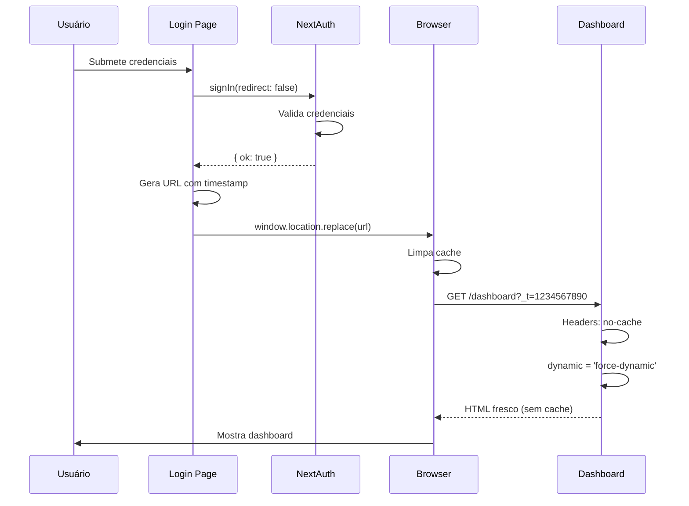

# 🔧 Correção do Problema de Cache no Mobile

## Problema Identificado

Após o login, o redirecionamento para o dashboard funcionava no desktop (com CTRL+F5), mas falhava no mobile com erro `ERR_FAILED`. O problema era o **cache agressivo** do navegador.

### Sintomas:
- ✅ Desktop: Funciona com CTRL+F5 (hard refresh)
- ❌ Mobile: Não funciona (não tem CTRL+F5)
- ❌ Erro: `ERR_FAILED` ou página em branco
- ❌ Causa: Cache do navegador retornando versão antiga da página

## Solução Implementada

### 1. Redirecionamento Manual com Timestamp (`login/page.tsx`)

```typescript
// ❌ ANTES - NextAuth gerenciava (usava cache)
const result = await signIn("credentials", {
  email: email.trim(),
  password,
  redirect: true,  // ❌ Usa cache
  callbackUrl,
})

// ✅ DEPOIS - Controle manual com bypass de cache
const result = await signIn("credentials", {
  email: email.trim(),
  password,
  redirect: false,  // ✅ Controle manual
})

if (!result?.error) {
  // Adiciona timestamp único para evitar cache
  const urlWithTimestamp = `${callbackUrl}${callbackUrl.includes('?') ? '&' : '?'}_t=${Date.now()}`
  
  // window.location.replace() força navegação completa
  // (não usa cache, substitui histórico)
  window.location.replace(urlWithTimestamp)
}
```

**Por que funciona:**
- `redirect: false` - Desativa redirecionamento automático do NextAuth
- `_t=${Date.now()}` - Torna a URL única a cada login
- `window.location.replace()` - Força navegação completa sem cache
- Substitui entrada no histórico (não acumula páginas de login)

### 2. Headers HTTP no Next.js Config (`next.config.js`)

Adicionado headers específicos para a dashboard:

```javascript
{
  // Headers específicos para a dashboard - evitar cache
  source: '/dashboard/:path*',
  headers: [
    {
      key: 'Cache-Control',
      value: 'no-store, no-cache, must-revalidate, proxy-revalidate, max-age=0'
    },
    {
      key: 'Pragma',
      value: 'no-cache'
    },
    {
      key: 'Expires',
      value: '0'
    },
  ],
}
```

**Explicação dos headers:**
- `no-store` - Não armazena nada em cache
- `no-cache` - Revalida antes de usar cache
- `must-revalidate` - Força revalidação quando expira
- `proxy-revalidate` - Mesmo para proxies
- `max-age=0` - Considera imediatamente expirado
- `Pragma: no-cache` - Compatibilidade HTTP/1.0
- `Expires: 0` - Marca como já expirado

### 3. Layout da Dashboard (`dashboard/layout.tsx`)

Forçar renderização dinâmica no servidor:

```typescript
// Forçar revalidação para evitar cache
export const dynamic = 'force-dynamic'
export const revalidate = 0
```

**O que isso faz:**
- `dynamic = 'force-dynamic'` - Força SSR em todas as requisições
- `revalidate = 0` - Não cacheia a página nunca
- Garante que a dashboard sempre é recriada do zero

### 4. Middleware (`middleware.ts`)

Headers já estavam configurados corretamente:

```typescript
response.headers.set('Cache-Control', 'no-store, no-cache, must-revalidate, proxy-revalidate');
response.headers.set('Pragma', 'no-cache');
response.headers.set('Expires', '0');
```

## Como Funciona o Fluxo Completo



## Por que `window.location.replace()`?

### Comparação de métodos:

| Método | Cache? | Histórico | Mobile | Recomendado |
|--------|--------|-----------|--------|-------------|
| `router.push()` | ✅ Sim | Adiciona | ⚠️ Inconsistente | ❌ |
| `window.location.href` | ✅ Sim | Adiciona | ⚠️ As vezes | ❌ |
| `window.location.replace()` | ❌ Não | Substitui | ✅ Sempre | ✅ |

**Vantagens do `replace()`:**
1. Não usa cache (navegação "limpa")
2. Substitui histórico (volta vai para antes do login)
3. Funciona consistentemente no mobile
4. Compatível com todos os navegadores

## Por que o Timestamp?

```javascript
const urlWithTimestamp = `${callbackUrl}?_t=${Date.now()}`
```

O timestamp torna cada URL **única**, então:
- Navegador não pode usar cache (URL diferente)
- Service Worker não intercepta (URL nova)
- Garante requisição fresca ao servidor

**Exemplo:**
```
/dashboard         → pode usar cache ❌
/dashboard?_t=1234 → URL única, sem cache ✅
/dashboard?_t=5678 → URL única, sem cache ✅
```

## Testando a Solução

### No Desktop (Chrome):
1. Fazer login normalmente
2. Verificar URL tem `?_t=` no final
3. Deve redirecionar sem precisar F5

### No Mobile (qualquer navegador):
1. Abrir navegador privado/anônimo
2. Fazer login
3. Deve redirecionar instantaneamente
4. Dashboard deve carregar completamente

### Verificar Headers (DevTools):
```
Request URL: https://nitrobeer.com.br/dashboard?_t=1696636800000
Request Method: GET
Status Code: 200 OK

Response Headers:
Cache-Control: no-store, no-cache, must-revalidate
Pragma: no-cache
Expires: 0
```

## Troubleshooting

### Se ainda houver problema de cache:

1. **Limpar cache do navegador**
   ```
   Mobile: Configurações → Privacidade → Limpar cache
   ```

2. **Verificar Service Worker**
   - DevTools → Application → Service Workers
   - Clicar em "Unregister" se houver

3. **Verificar se o build está atualizado**
   ```bash
   pnpm build
   # Verificar que a mudança foi aplicada
   ```

4. **Verificar no servidor de produção**
   - Headers devem estar presentes
   - URL deve ter timestamp
   - Response não deve vir de cache

### Logs úteis para debug:

```typescript
// Adicionar no handleSubmit se necessário:
console.log('🔐 Login result:', result)
console.log('🔄 Redirecting to:', urlWithTimestamp)
console.log('⏰ Timestamp:', Date.now())
```

## Considerações de Performance

### Impacto:
- ⚠️ Dashboard sempre faz SSR (não cacheia)
- ⚠️ Pode ser mais lento em conexões lentas
- ✅ Garante dados sempre atualizados
- ✅ Evita bugs de cache

### Otimizações futuras (se necessário):
- Cachear recursos estáticos (CSS, JS, imagens)
- Usar SWR/React Query para cache client-side
- Implementar ISR para partes específicas
- Service Worker inteligente (offline-first)

## Conclusão

A solução é uma combinação de:
1. ✅ Redirecionamento manual com timestamp
2. ✅ Headers HTTP agressivos
3. ✅ Force-dynamic no layout
4. ✅ window.location.replace()

Isso garante que o login funcione **perfeitamente em todos os dispositivos**, sem depender de atalhos como CTRL+F5.

## Arquivos Modificados

- ✅ `app/(auth)/login/page.tsx` - Redirecionamento manual
- ✅ `next.config.js` - Headers HTTP
- ✅ `app/(app)/dashboard/layout.tsx` - Force dynamic
- ✅ `middleware.ts` - Headers (já estava ok)

## Checklist de Testes

- [ ] Login no desktop Chrome
- [ ] Login no desktop Firefox
- [ ] Login no mobile Chrome
- [ ] Login no mobile Safari (iOS)
- [ ] Login em modo anônimo/privado
- [ ] Verificar URL tem timestamp
- [ ] Verificar headers no Network tab
- [ ] Verificar não há ERR_FAILED
- [ ] Dashboard carrega completamente
- [ ] Dados aparecem corretamente
