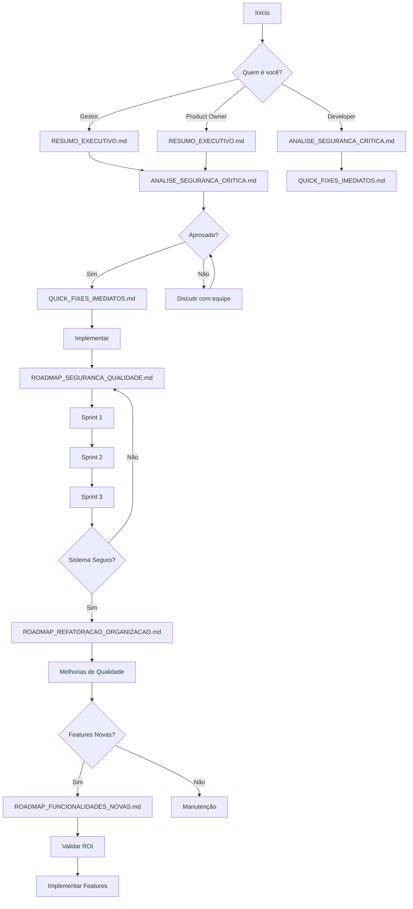

# 📑 Índice da Documentação

**Criado em:** 14/10/2025  
**Última atualização:** 14/10/2025

---

## 🚀 Início Rápido

### Nunca leu antes? Comece por aqui:

```
1. RESUMO_EXECUTIVO.md               (5 min)
   ↓
2. ANALISE_SEGURANCA_CRITICA.md      (10 min)
   ↓
3. QUICK_FIXES_IMPLEMENTADOS.md      (✅ JÁ IMPLEMENTADO)
   ↓
4. MELHORIAS_IMPLEMENTADAS.md        (✅ NOVAS FUNCIONALIDADES)
   ↓
5. ROADMAP_SEGURANCA_QUALIDADE.md    (próximos passos)
```

---

## ✅ Implementações Concluídas

### [QUICK_FIXES_IMPLEMENTADOS.md](./QUICK_FIXES_IMPLEMENTADOS.md)
**Status:** ✅ CONCLUÍDO  
**Data:** 14/10/2025

Correções rápidas de segurança implementadas:
- ✅ Logger melhorado com sanitização
- ✅ Validações de range em rotas críticas
- ✅ Mudança obrigatória de senha admin
- ✅ Sanitização de inputs
- ✅ Headers de segurança (CSP, HSTS)
- ✅ Tokens hardcoded removidos

### [MELHORIAS_IMPLEMENTADAS.md](./MELHORIAS_IMPLEMENTADAS.md) 🆕
**Status:** ✅ CONCLUÍDO  
**Data:** 14/10/2025

Novas funcionalidades implementadas:
- ✅ Rate Limiting Global (proteção DDoS)
- ✅ Sistema de Validações Zod (centralizado)
- ✅ Logging Melhorado (persistência + audit)
- ✅ Mais de 1.500 linhas de código
- ✅ TypeScript type-safe completo

---

## 📚 Todos os Documentos

### 1. 📊 [RESUMO_EXECUTIVO.md](./RESUMO_EXECUTIVO.md)
**Para quem:** Todos (gestores, devs, stakeholders)  
**Tempo de leitura:** 5 minutos  
**Quando ler:** PRIMEIRO

**O que contém:**
- ✅ Visão geral do projeto
- ⚠️ Problemas identificados
- 💰 Análise de custo/benefício
- 📋 Plano de ação resumido
- 🎯 Recomendações

**Por que ler:**
Entender rapidamente a situação e decisões necessárias.

---

### 2. 🔒 [ANALISE_SEGURANCA_CRITICA.md](./ANALISE_SEGURANCA_CRITICA.md)
**Para quem:** Todos  
**Tempo de leitura:** 10 minutos  
**Quando ler:** Logo após o resumo

**O que contém:**
- 🚨 10 problemas críticos de segurança
- 📊 Estatísticas da análise
- ✅ Pontos positivos encontrados
- 📋 Checklist de segurança
- 🎯 Priorização de correções

**Por que ler:**
Conhecer os riscos reais e sua gravidade.

**Destaques:**
- Ausência de rate limiting (DDoS)
- Logs excessivos em produção
- Validações incompletas
- Senha admin padrão
- Sem backup automatizado

---

### 3. 🚀 [QUICK_FIXES_IMEDIATOS.md](./QUICK_FIXES_IMEDIATOS.md)
**Para quem:** Desenvolvedores  
**Tempo de implementação:** 2-3 horas  
**Quando implementar:** HOJE

**O que contém:**
- 6 correções de segurança rápidas
- Código pronto para usar
- Passo a passo detalhado
- Como testar cada fix
- Checklist de validação

**Por que implementar:**
Mitigar 50% dos riscos críticos com apenas 3 horas de trabalho.

**Fixes incluídos:**
1. Melhorar logger existente (30 min)
2. Validação de ranges (45 min)
3. Forçar mudança senha admin (45 min)
4. Sanitização de buscas (20 min)
5. Headers de segurança (15 min)
6. Remover tokens hardcoded (5 min)

---

### 4. 🛡️ [ROADMAP_SEGURANCA_QUALIDADE.md](./ROADMAP_SEGURANCA_QUALIDADE.md)
**Para quem:** Desenvolvedores, Tech Leads  
**Tempo de implementação:** 3-4 semanas  
**Quando implementar:** Próximos sprints

**O que contém:**
- 3 sprints detalhados (semana a semana)
- 13 tasks com código completo
- Exemplos práticos
- Testes para cada feature
- Métricas de sucesso

**Por que implementar:**
Sistema production-ready com segurança enterprise.

**Sprints:**
```
Sprint 1: Segurança Crítica (Semana 1)
├─ Rate Limiting
├─ Logger Centralizado
├─ Validação de Inputs
└─ Senha Admin

Sprint 2: Robustez (Semana 2)
├─ Soft Delete
├─ Backup Automatizado
├─ Validações Zod
└─ CSRF Protection

Sprint 3: Monitoramento (Semana 3)
├─ CORS
├─ Sentry
└─ Testes de Segurança
```

---

### 5. 🗂️ [ROADMAP_REFATORACAO_ORGANIZACAO.md](./ROADMAP_REFATORACAO_ORGANIZACAO.md)
**Para quem:** Desenvolvedores  
**Tempo de implementação:** 2-3 semanas  
**Quando implementar:** Após segurança

**O que contém:**
- 3 sprints de melhorias
- Reestruturação de código
- Otimizações de performance
- Documentação e testes

**Por que implementar:**
Código limpo, performático e manutenível.

**Melhorias:**
```
Sprint 1: Reorganização
├─ Reestruturar hooks
├─ Consolidar validações
├─ Refatorar componentes
└─ Utilitários compartilhados

Sprint 2: Performance
├─ Lazy loading
├─ Otimizar queries Prisma
├─ Caching (React Query + Next)
└─ Reduzir bundle size

Sprint 3: Qualidade
├─ JSDoc em componentes
├─ Testes unitários
└─ Documentação de API
```

**Ganhos esperados:**
- 📦 -30% bundle size
- ⚡ -40% tempo de carregamento
- 🧹 +50% manutenibilidade

---

### 6. 🚀 [ROADMAP_FUNCIONALIDADES_NOVAS.md](./ROADMAP_FUNCIONALIDADES_NOVAS.md)
**Para quem:** Product Owners, Stakeholders  
**Tempo de implementação:** 4-6 semanas (por categoria)  
**Quando implementar:** ⚠️ CONSULTAR PRIMEIRO

**O que contém:**
- 20+ sugestões de funcionalidades
- 5 categorias de features
- Análise de ROI
- Estimativas de esforço
- Priorização por valor

**Por que consultar:**
Ter opções de evolução do produto baseadas em valor de negócio.

**Categorias:**
```
📊 Analytics Avançado
├─ Dashboard Executivo
├─ Análise RFM de Clientes
├─ Heatmap de Vendas
└─ Detecção de Anomalias

🤖 Automação e IA
├─ Previsão de Demanda ML
├─ Reabastecimento Automático
└─ Recomendações Personalizadas

🔗 Integrações
├─ E-commerce (WooCommerce, Shopify)
├─ Delivery (iFood, Rappi)
└─ Fiscal (NFC-e, NF-e)

📱 Mobile e Offline
├─ PWA Completo
└─ App Nativo React Native

📈 Relatórios Avançados
├─ Report Builder
├─ Dashboards Customizáveis
└─ Exportação Avançada
```

**⚠️ IMPORTANTE:**  
Não implementar antes de:
1. Segurança completa (Fase 1 e 2)
2. Validação com usuários
3. Cálculo de ROI
4. Priorização de negócio

---

### 7. 📚 [README_ROADMAPS.md](./README_ROADMAPS.md)
**Para quem:** Todos  
**Tempo de leitura:** 15 minutos  
**Quando ler:** Para visão completa

**O que contém:**
- Índice de todos os documentos
- Guia de como usar os roadmaps
- Plano de execução completo
- Métricas de acompanhamento
- Próximos passos

**Por que ler:**
Entender como todos os documentos se conectam e como usar efetivamente.

---

## 🎯 Fluxograma de Leitura



---

## 📋 Checklist de Progresso

### Fase 1: Leitura e Planejamento
- [ ] Li RESUMO_EXECUTIVO.md
- [ ] Li ANALISE_SEGURANCA_CRITICA.md
- [ ] Entendi os riscos
- [ ] Aprovação de stakeholders
- [ ] Planejamento de sprints

### Fase 2: Quick Wins (3 horas)
- [ ] Logger melhorado
- [ ] Validações de range
- [ ] Senha admin obrigatória
- [ ] Sanitização de buscas
- [ ] Headers de segurança
- [ ] Tokens removidos
- [ ] Testado localmente
- [ ] Deploy staging

### Fase 3: Segurança (2-3 semanas)
- [ ] Rate limiting implementado
- [ ] Logger centralizado
- [ ] Validações completas
- [ ] Soft delete
- [ ] Backup automatizado
- [ ] CSRF protection
- [ ] Monitoramento configurado
- [ ] Testes de segurança
- [ ] Deploy produção

### Fase 4: Qualidade (2-3 semanas)
- [ ] Hooks reestruturados
- [ ] Validações consolidadas
- [ ] Componentes refatorados
- [ ] Performance otimizada
- [ ] Testes unitários
- [ ] JSDoc completo
- [ ] Documentação atualizada

### Fase 5: Features Novas (opcional)
- [ ] ROI calculado
- [ ] Validado com usuários
- [ ] Priorizado
- [ ] Implementado gradualmente

---

## 🎓 Glossário

### Termos Técnicos

**Rate Limiting**
Limitar número de requisições por IP/usuário para prevenir abuso e DDoS.

**Soft Delete**
Marcar registro como deletado sem remover do banco. Permite recuperação.

**Sanitização**
Remover/escapar caracteres perigosos de inputs do usuário.

**CSRF**
Cross-Site Request Forgery - ataque que força usuário a executar ações não intencionais.

**CORS**
Cross-Origin Resource Sharing - controla quais origens podem acessar a API.

**CSP**
Content Security Policy - previne XSS definindo fontes permitidas de conteúdo.

**RFM**
Recency, Frequency, Monetary - análise de comportamento de clientes.

**ROI**
Return on Investment - retorno sobre investimento.

---

## 📞 Suporte

### Dúvidas sobre o conteúdo?

**Documentação:**
- Leia novamente devagar
- Cada documento tem exemplos práticos
- Código completo está incluído

**Implementação:**
- Siga o passo a passo
- Não pule etapas
- Teste cada mudança

**Priorização:**
- Segurança SEMPRE primeiro
- Qualidade antes de features
- ROI guia decisões

---

## 📊 Estatísticas da Análise

```
Arquivos analisados:        720+
Rotas de API:              140
Console.logs encontrados:   100+
Problemas críticos:         10
Problemas médios:          15
Sugestões de melhoria:     50+
Linhas de código geradas:  3000+
Tempo de análise:          2 horas
Tempo estimado correção:   60-90 horas
```

---

## 🏆 Critérios de Sucesso Final

### Segurança ✅
- [ ] 0 vulnerabilidades críticas
- [ ] Rate limiting 100% ativo
- [ ] Backup diário funcionando
- [ ] Logs sanitizados
- [ ] Pentest passou

### Qualidade ✅
- [ ] 0 console.log em produção
- [ ] 70%+ cobertura testes
- [ ] 90+ Lighthouse score
- [ ] Documentação completa

### Performance ✅
- [ ] Load time < 2s
- [ ] Query time < 200ms
- [ ] Bundle size -30%
- [ ] 95+ Performance score

### Negócio ✅
- [ ] Zero downtime
- [ ] Usuários satisfeitos
- [ ] Features entregues no prazo
- [ ] ROI positivo

---

## 🎯 Mensagem Final

Você tem em mãos um **plano completo de ação** para elevar seu sistema a padrões enterprise.

**Próximo passo:** 
Comece por `RESUMO_EXECUTIVO.md` e siga o fluxo.

**Lembre-se:**
- 🔒 Segurança primeiro
- 🧹 Qualidade depois
- 🚀 Features por último
- 💰 ROI sempre

**Boa sorte! 🚀**

---

**Última atualização:** 14/10/2025  
**Próxima revisão:** Após conclusão Fase 1
